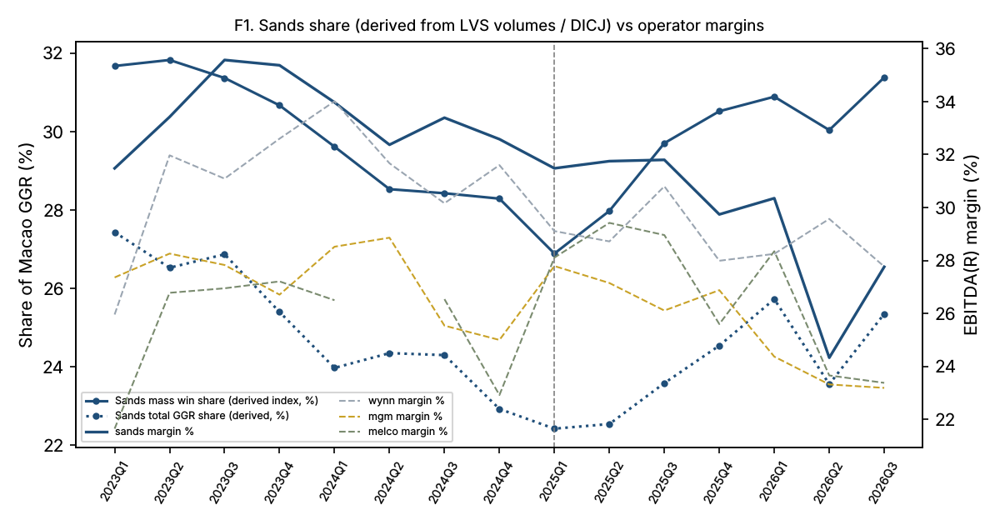
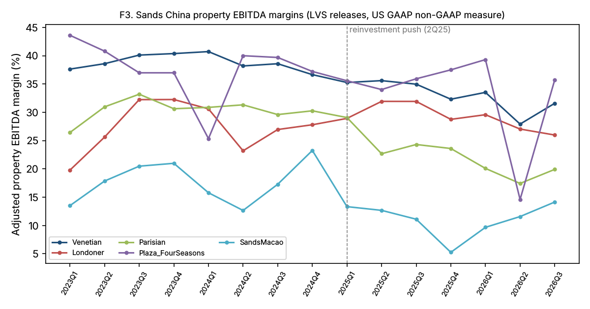
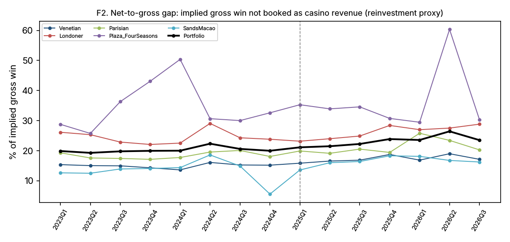
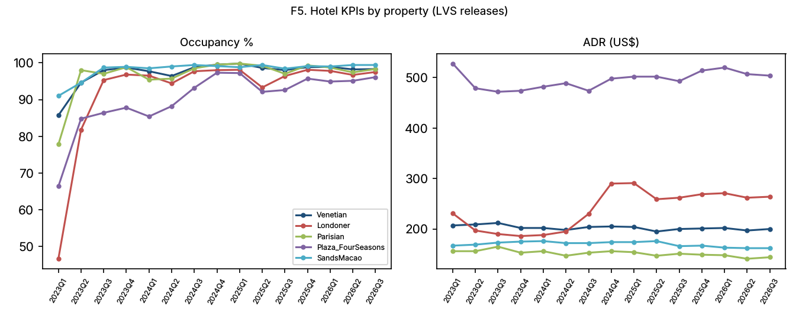
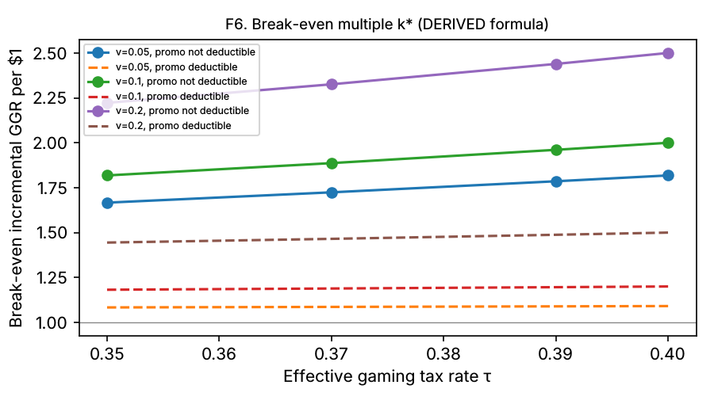
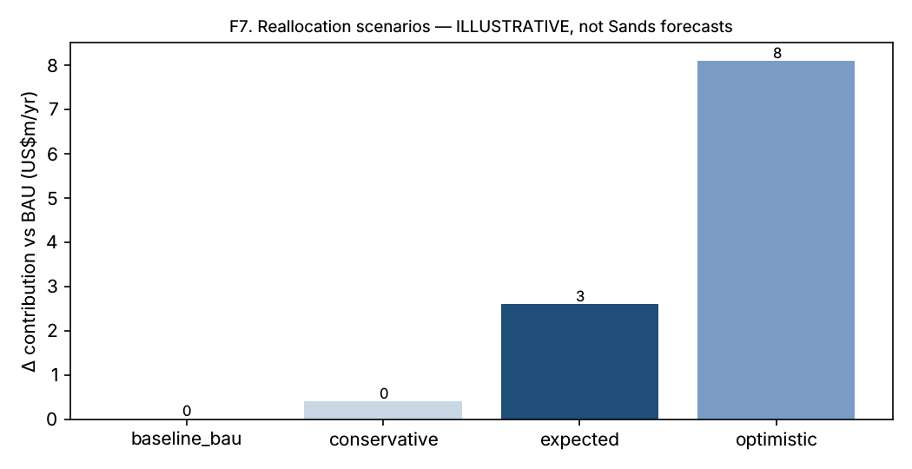
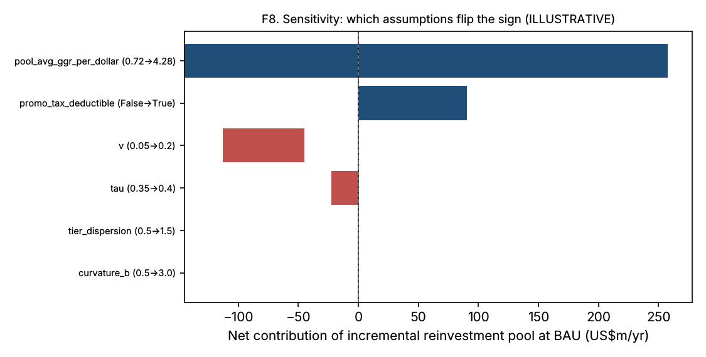

> **Independence statement.** This is independent research by an external analyst, using only public
> information: Las Vegas Sands (LVS) SEC filings, Macao Gaming Inspection and Coordination Bureau (DICJ)
> statistics, peer filings, published research and press. The author has no affiliation with, internal
> access to, or endorsement from Sands China Ltd. or Las Vegas Sands Corp. Figures marked *illustrative*
> are not Sands figures or forecasts. Every number traces to `research/sources/` and `research/outputs/`.

## 1. Executive summary

**The decision.** From late April 2025 Sands China raised mass-market customer reinvestment (free play,
rebates, complimentary rooms and other incentives) to recover market share. Management said the level
would be market-driven, not set to a margin target. The decision this report addresses is how to size and
allocate the *next* increment of reinvestment across the five Macao properties and customer tiers so that
it earns positive incremental profit after Macao's ~40% gaming tax.

**What the public evidence shows** (2Q25–3Q26 against 3Q23–1Q25, LVS and DICJ primary data):

1. **Share has recovered.** Sands' derived share of Macao total GGR rose from 22.4% (1Q25) to 25.4% (3Q26).
   The derived mass-win index rose 4.5 points.
2. **More of gross win is being reinvested.** The gap between implied gross win and booked casino revenue
   rose from 20.5% to 23.5% of gross win. That is about **US$226m a year** of additional deductions
   (rebates, discounts, comps and commissions combined; a proxy, not a promotional ledger).
3. **Margins fell, partly market-wide.** Sands' adjusted property EBITDA margin fell 4.2 points between
   the two periods. Peers fell 0.2–2.6 points. The difference, about −2.8 points (−2.0 excluding the
   low-hold 2Q26), is consistent with reinvestment costs, but the period also includes the Londoner ramp
   and satellite-casino closures. Sands' 3Q26 margin (27.8%) remains at or above the three peers that
   file with the SEC (23.2–27.8%).
4. **Whether the increment pays is not determinable from public data.** Implied average returns range from
   0.4× to 2.1× of cost, depending on how much of the share gain is attributed to reinvestment. Break-even
   is 1.0× on this measure.
5. **Hotels are effectively full.** Mean occupancy since 2Q25 was 98.5% at The Venetian, 98.3% at The
   Parisian and 99.1% at Sands Macao. On those nights a complimentary room displaces a paying guest, so
   its true cost is closer to the cash rate than to housekeeping cost
   (about US$94–211 a night under *illustrative* sell-out probabilities, vs ~US$40 when not full).

**Recommendation.** Management could consider a 12-week randomised reinvestment holdout across all
properties. Its purpose is to measure the *marginal* return of the post-2Q25 increment by tier. It would
pair with a room-comp substitution test on forecast sell-out nights. Casino Marketing would own it with
FP&A. The action is sized so that at most 5–10% of each mass cell receives a changed offer.
Success means a 90% confidence lower bound above zero on incremental contribution per player, with no
guardrail breach on visits, share, customer experience or responsible gambling.

## 2. The decision and why it matters now

Five candidate decisions were scored against materiality, strategic relevance, data availability,
external evidence, feasibility and actionability (spec §3). The reinvestment decision scored highest
(4.60/5); hotel room allocation (3.60) was folded into it as a reinvestment channel.

The timing matters for three reasons:

- **It is an active choice.** Management described the reinvestment step-up on the Q2 2025 call and said
  the level would follow the market. *(Call transcript, secondary copy.)*
- **The competitive context changed again in 2026.** SJM's satellite casinos closed on 30–31 December 2025;
  they generated about HK$9.77bn (~US$1.25bn) of GGR in 2025. All six concessionaires competed for that play,
  partly through lower minimum bets and incentives. *(Press, secondary.)*
- **The economics are unforgiving.** With ~40% of GGR paid in gaming tax and levies, a dollar of
  reinvestment must generate about two dollars of *incremental* GGR to break even (Section 7).

## 3. The Macao competitive environment

| Metric (DICJ, MOP m) | 2024 | 2025 | 3Q26 |
|---|---|---|---|
| Games of fortune GGR | 226,782 | 247,404 (+9.1%) | 60,215 |
| Mass share of GGR (ex-VIP baccarat) | — | 72.5% | 71.9% |

*Source: DICJ quarterly statistics (report 1 and 3), accessed 13 Nov 2026. 1 HKD = 1.03 MOP per DICJ.*

**Peer margins** (EBITDA or EBITDAR as each operator defines it; directional only):

| Operator (Macau) | 1Q25 | 3Q25 | 1Q26 | 3Q26 | Mean change, post vs pre |
|---|---|---|---|---|---|
| Sands China (5 properties, adj. property EBITDA) | 31.5% | 31.8% | 30.4% | 27.8% | −4.2 pts |
| Wynn Macau + Wynn Palace (adj. property EBITDAR) | 29.1% | 30.8% | 28.2% | 27.8% | −2.6 pts |
| MGM China (segment adj. EBITDAR) | 27.8% | 26.1% | 24.4% | 23.2% | −2.0 pts |
| Melco Macau properties (adj. EBITDA) | 28.1% | 29.0% | 28.4% | 23.4% | +0.2 pts |

Galaxy Entertainment and SJM do not file with the SEC and were not included. This is a documented gap.
MGM China reported a record 17.1% market share in 3Q26, which shows that rival operators were also
competing for share. EBITDAR excludes rent, so Wynn and MGM margins are not strictly comparable with
Sands' EBITDA.

## 4. What comparable operators teach

Sixteen cases were reviewed and graded (`sources/case_register.csv`). Three lessons matter:

1. **Control groups, not intuition.** Harrah's (now Caesars) is the best-known example of offer decisions
   tested against control groups (Loveman, *HBR*, May 2003). The evidence is executive-authored (grade E3):
   persuasive on method, not proof of effect size.
2. **Established players often do not respond to free play.** Peer-reviewed studies using real casino data
   (Lucas & Spilde 2017, 2024; Lucas, Cho & Singh 2020; grade E2) found little response to free-play
   *reductions*. Visitation fell about 20% only where free play was eliminated entirely. These are US
   slot-player studies, so the effect sizes do **not** transfer to Macao's baccarat-led mass market. The
   hypothesis and test design do.
3. **Rooms are a reinvestment currency.** Harrah's Cherokee's revenue management priced rooms by total guest
   value (Metters et al., *Interfaces*, 2008, grade E3, co-authored with vendors). It reported ~15% revenue
   gains against 3–7% for typical installations.

Vendor case studies (workforce scheduling, AI personalisation) report large gains but disclose no
counterfactuals. They are graded E4 and used only to generate test ideas.

## 5. Sands China financial analysis

### 5.1 Portfolio trend

| Quarter | Net revenue (US$m) | Adj. property EBITDA (US$m) | Margin | Hold-adjusted margin | Net-to-gross gap |
|---|---|---|---|---|---|
| 1Q25 | 1,677 | 528 | 31.5% | 32.1% | 21.1% |
| 3Q25 | 1,874 | 596 | 31.8% | 31.7% | 22.2% |
| 1Q26 | 2,076 | 630 | 30.4% | 29.6% | 23.5% |
| 2Q26 | 1,751 | 426 | 24.3% | 29.3% | 26.4% |
| 3Q26 | 1,902 | 528 | 27.8% | 27.2% | 23.5% |

*Five Macao properties, excluding ferry and other operations. Source: LVS earnings releases (8-K Ex.99.1).
Hold adjustment uses LVS's own disclosed impact of normalising rolling-chip win to 3.3%. 2Q26 included an
unusually low rolling hold, worth about US$87m of EBITDA.*

On a hold-adjusted basis the margin has drifted down steadily since 1Q25 (32.1% → 27.2%). This was not a
single-quarter shock.

### 5.2 Property bridge, 3Q26 vs 3Q25

| Property | Δ Net revenue | Δ EBITDA | Δ Margin | EBITDA effect of margin change |
|---|---|---|---|---|
| The Venetian Macao | −43 | −37 | −3.4 pts | −22 |
| The Londoner Macao | −1 | −41 | −5.9 pts | −41 |
| The Parisian Macao | +13 | −7 | −4.4 pts | −10 |
| The Plaza & Four Seasons | +32 | +11 | −0.2 pts | −1 |
| Sands Macao | +27 | +6 | +3.0 pts | +3 |

*US$m. Source: LVS-ER 21 Oct 2026; bridge computed in `analysis/public_analysis.py`.*

Margin compression is concentrated at The Londoner and The Venetian. At The Venetian, about 500 rooms are
out of service for renovation through 4Q27 (LVS footnote), so part of its decline is capacity rather than
reinvestment. Over the full post-period, margins moved very differently by property: Parisian −9.4 pts,
Sands Macao −6.9, Venetian −5.9, Plaza/Four Seasons −3.1, Londoner +0.3. The Londoner's stability masks
the return of its rooms during the ramp.

### 5.3 The reinvestment proxy

LVS discloses mass table drop and win rate, slot handle and hold, and rolling volume and win rate for each
property. From these, gross gaming win can be reconstructed and compared with booked casino revenue. The
difference ("net-to-gross gap") contains rebates, commissions, discounts, loyalty deferrals and comps
allocated to rooms and F&B. It is **not** a promotional ledger, but its change is informative.

| Property | Gap, 3Q23–1Q25 | Gap, 2Q25–3Q26 |
|---|---|---|
| The Venetian | 15.0% | 17.5% |
| The Londoner | 23.9% | 26.7% |
| The Parisian | 18.5% | 21.4% |
| The Plaza & Four Seasons | 36.9% | 36.5% |
| Sands Macao | 13.5% | 16.9% |
| **Portfolio** | **20.5%** | **23.5%** |

The step-up appears at every property except The Plaza & Four Seasons, which serves a premium clientele.
That pattern is consistent with a broad-based mass reinvestment programme.

### 5.4 Hotels

Revenue mix, 3Q26 (% of net revenue; LVS-ER): casino 78/75/77/69/93 and rooms 7/15/14/13/4 for
Venetian/Londoner/Parisian/Plaza & Four Seasons/Sands Macao (table F4, `outputs/tables/F4_revenue_mix_2026Q3_pct.csv`).

Average occupancy since 2Q25: Venetian 98.5%, Parisian 98.3%, Sands Macao 99.1%, Londoner 96.6%,
Plaza/Four Seasons 94.4%; ADRs US$147–507. Hotels this full make the opportunity cost of complimentary
rooms material.

### 5.5 Comparison with peers (quasi-experimental, weak identification)

A difference-in-differences comparison of mean margins (post 2Q25–3Q26 vs pre 3Q23–1Q25) gives Sands
**−2.8 points** relative to the peer average. Robustness checks:

- Hold-adjusting Sands: −2.8.
- Excluding 2Q26: −2.0.
- Leaving out one peer at a time: −1.9 to −3.3.
- Placebo start dates in 2024: −0.2 to −0.9.

The post-2Q25 divergence is therefore larger than in earlier periods. It cannot be attributed to
reinvestment alone. Three peers is a small sample, their EBITDA definitions differ, and the treatment
coincides with the Londoner ramp and the satellite closures.

## 6. Transferability

Of eight candidate approaches, two transfer with adaptation and one does not transfer at all:

- **Transfer with adaptation:** control-group offer testing, and total-guest-value room allocation.
- **Hypotheses to test, not results:** free-play right-sizing for established players, and reactivation
  of new or lapsed players.
- **Not prioritised:** labour scheduling (weak evidence).
- **Not transferable:** online ML bonus personalisation (online gaming is illegal in Macau).

The Macau-specific adaptations are:

- Process customer data in Macau on pseudonymised IDs (Personal Data Protection Act, Law 8/2005).
- Exclude players flagged for responsible gambling from any test.
- Review host-managed premium players case by case rather than randomising them.
- Allow for the 2026 competitive scramble.

Full reasoning chains and the decision matrix are in `deliverables/transfer_analysis.md`.

## 7. Quantitative decision framework

**Break-even.** The incremental GGR needed per $1 of reinvestment is k* = c / (1 − τ − v), where:

- τ is the gaming tax rate (~40%);
- v is variable cost as a share of GGR (*illustrative* 10%);
- c is 1, or 1 − τ if promotional play reduces taxable GGR. That tax treatment is not yet verified.

k* = **2.0×**, or 1.2× if promotional play is tax-deductible.

**Public-data anchor** (DERIVED, average not marginal, not causal):

| Share gain used | Share of gain attributed to reinvestment | Incremental GGR (US$m/yr) | Contribution before reinvestment (US$m/yr) | Incremental deductions (US$m/yr) | Return multiple |
|---|---|---|---|---|---|
| Company definition +2.5 pts *(company-reported on calls)* | 100% | 539 | 270 | 226 | 1.19× |
| Company definition +2.5 pts | 50% | 270 | 135 | 226 | 0.60× |
| Derived index +4.5 pts | 100% | 968 | 484 | 226 | 2.14× |
| Derived index +4.5 pts | 50% | 484 | 242 | 226 | 1.07× |

**Scenario model** (*illustrative*; `analysis/scenarios.py`). The incremental pool is split into
property × tier cells with diminishing-returns response curves. The curves are ordered by the literature
(established players respond least) and calibrated so that the pool breaks even on average. Findings:

- **Reallocation across cells adds little:** US$0.4m (conservative), US$2.6m (expected) and US$8.1m
  (optimistic) a year, with the share guardrail met in every scenario.
- **The level of the increment matters more.** With diminishing returns, an increment that breaks even on
  average has marginal dollars *below* break-even. In the base case, the best-performing pool size is
  25–50% of the current increment.
- **The sign depends on unknown inputs.** The sign of the pool's net contribution flips with the true
  response level, v, τ and the tax treatment of promotional play. Public data does not identify any of
  these, so the conclusion rests on a test rather than on the model.

## 8. Recommended next action

| Element | Recommendation |
|---|---|
| Action | 12-week randomised reinvestment holdout (8 weeks of treatment plus 4 of follow-up) in every property × mass tier. Arms: current offer; −30% offer; reallocated offer. Plus a room-comp vs non-room-reward test on nights forecast at ≥97% occupancy |
| Owner | Casino Marketing (design and offers), with FP&A (measurement) and Hotel Revenue Management (room test); Compliance sign-off |
| Financial mechanism | Remove reinvestment that does not change behaviour; recover cash room revenue on sell-out nights; redeploy savings to cells with measured positive return |
| Metric | Incremental contribution per player = Δtheo·(1−τ−v) − Δreinvestment − Δroom opportunity cost |
| Threshold | Adopt a change in a cell only if the 90% CI lower bound is > 0 and no guardrail is breached (visits, share, complaints, responsible gambling, host attrition) |
| Timeline | 4 weeks of design and compliance; 12 weeks in market; a decision at week 17 |
| Exposure | At most 5–10% of each cell receives a changed offer (size *illustrative*; Sands would set it from its own variance data) |

**What would change this recommendation:** confirmation, from internal data or the test itself, that the
marginal return in most cells exceeds 2× (or 1.2× if promotional play is tax-deductible). In that case
the increment should be kept or raised.

The full protocol is in `deliverables/experiment_protocol.md`; the internal data it needs is listed in
`deliverables/internal_data_request.md`.

## 9. Risks, competing explanations and limitations

| Competing explanation for lower margins | Status |
|---|---|
| Rolling hold variance | Addressed: hold-adjusted series, LVS's own adjustment |
| Premium-segment weakness (management's 3Q26 explanation) | Partly visible: Venetian rolling win 3.97% vs 5.87%; not separable from mass economics |
| Londoner ramp and Venetian room renovation | Present; cannot be separated with public data |
| Labour and other opex inflation, deliberate service investment | Management describes "investments in enhanced service and hospitality offerings"; cost lines are not disclosed by property |
| Competitor incentives after satellite closures | Market-wide; partly netted by the peer comparison |
| Accounting reclassification | No restatement detected (comparatives match prior reports in integrity tests) |

**Limitations:**

- There is no customer-level or offer-level data.
- The net-to-gross gap mixes several deduction types.
- The share index differs from the company's definition. The derived total GGR share does match CLSA's
  25.4% for 3Q26.
- Only three peers are included, with mixed EBITDA definitions.
- External studies are US- and slot-based.
- The tax treatment of promotional play is unverified.

**What cannot be concluded:** whether the current reinvestment level is profitable at the margin, or which
property or tier has the highest return.

## 10. References

*Primary data (66 registered sources with URLs and SHA-256 hashes in `sources/source_register.csv`):*

- Las Vegas Sands Corp., quarterly earnings releases (Form 8-K Ex.99.1), 25 Jan 2023 – 21 Oct 2026, SEC EDGAR, e.g.
  https://www.sec.gov/Archives/edgar/data/1300514/000130051426000099/lvs_ex991x09302026.htm
- DICJ, Gaming Statistics, quarterly, 2023–2026: https://www.dicj.gov.mo/web/en/information/DadosEstat/2026/report_en.xml
- Wynn Resorts, MGM Resorts International and Melco Resorts & Entertainment earnings releases, 2023–2026, SEC EDGAR.

*Research and secondary sources:*

- Loveman, G. (2003). Diamonds in the Data Mine. *Harvard Business Review*, May.
- Lucas, A. F., & Spilde, K. (2017). *Cornell Hospitality Quarterly*. Lucas & Spilde (2024). *UNLV Gaming
  Research & Review Journal* 28(1): https://oasis.library.unlv.edu/grrj/vol28/iss1/1
- Lucas, A. F., Cho, & Singh (2020). *Cornell Hospitality Quarterly*. https://journals.sagepub.com/doi/ref/10.1177/1938965520963047
- Metters, R. et al. (2008). The "Killer Application" of Revenue Management: Harrah's Cherokee Casino & Hotel.
  *Interfaces* 38(3), 161–175.
- Las Vegas Sands Q2 2025 earnings call transcript (secondary copy):
  https://www.fool.com/earnings/call-transcripts/2025/07/23/las-vegas-sands-lvs-q2-2025-earnings-transcript
- Macau gaming tax structure: GGRAsia (2022) https://www.ggrasia.com/macau-40pct-ggr-tax-in-new-law-ce-can-cut-up-to-5-points/
- Satellite closures: focusgn (2026) https://focusgn.com/asia-pacific/sjm-posts-2025-loss-as-satellite-casino-closures-impact-results
- Macau data protection: DLA Piper https://www.dlapiperdataprotection.com/?c=MO&t=law
